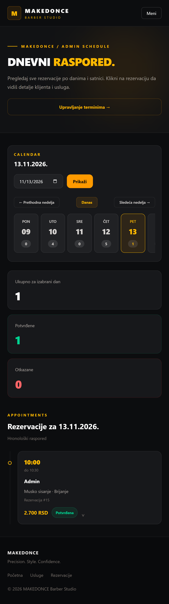

# MAKEDONCE Barber Studio

A Laravel appointment-booking app for a single barber shop. Customers can choose multiple services, reserve an available 30-minute slot, and manage their bookings. The admin controls the schedule and sees appointments in a day-by-day calendar.

I built this as a PHP/Laravel portfolio project, focusing on booking rules, database relationships, access control, and tests—not just CRUD pages.

## Screenshots

**Homepage**


**Admin daily schedule**



[Services](docs/screenshots/services.png) · [Book an appointment](docs/screenshots/booking.png) · [My bookings](docs/screenshots/my-bookings.png)

## What it does

**Customers**
- Register, sign in, and manage their own appointments.
- Browse services and select more than one per booking.
- See currently available slots and reserve an appointment.
- Cancel a booking, making its slot available again.
- See the original price of each service in their booking history.

**Admin**
- Add, edit, and remove services, subject to booking constraints.
- Publish available slots for a date and time range, or close an unreserved slot.
- Browse a weekly calendar and view each day's appointments in time order.
- Expand an appointment to see its customer, selected services, status, and total price.

**Booking rules**
- Slots are 30 minutes long; a booking is confirmed automatically.
- Availability is checked again on the server when a booking is submitted. Transactions and row locking help prevent double bookings.
- Each booking stores service prices in the `booking_service` pivot table (`price_at_booking`). Changing the current price does not alter past bookings.
- Customers can only manage their own reservations. Admin pages are restricted by authentication and authorization checks.

## Stack

- **Backend:** PHP 8.4, Laravel 13, Eloquent ORM
- **Database:** MySQL
- **Frontend:** Blade, Tailwind CSS 4, JavaScript, Vite
- **Testing:** PHPUnit / Laravel feature tests, SQLite in-memory test database

## Run locally

Requirements: PHP 8.4, Composer, MySQL, Node.js and npm. Enable PHP's SQLite driver to run the test suite.

```bash
composer install
npm install
```

Copy `.env.example` to `.env` (on Windows PowerShell, use `Copy-Item .env.example .env`), then generate an application key:

```bash
php artisan key:generate
```

Create an empty MySQL database, such as `booking_system`, and set your own connection details in `.env`:

```dotenv
DB_CONNECTION=mysql
DB_HOST=127.0.0.1
DB_PORT=3306
DB_DATABASE=booking_system
DB_USERNAME=your_local_username
DB_PASSWORD=your_local_password
```

Run the database migrations:

```bash
php artisan migrate
```

Start Laravel and Vite in separate terminals:

```bash
php artisan serve
```

```bash
npm run dev
```

Open `http://127.0.0.1:8000`.

New accounts are regular users. The application operator must assign admin access (`is_admin`) to a trusted account through the database; the registration form does not grant admin privileges.

## Tests

Run:

```bash
php artisan test
```

The test suite covers:
- Guest, regular-user, and admin access to protected pages.
- Rejecting a second booking for an occupied slot.
- Releasing a slot after cancellation and allowing it to be booked again.
- Keeping the original booking price after a service's current price changes.
- Loading the homepage successfully.

**Last local run:** 7 passed, 28 assertions (November 2026).

## Scope

This is a single-barber demo application, not a deployed production service. All appointments use fixed 30-minute slots, even when multiple services are selected; service durations are stored but do not determine booking length.

There are no online payments, email notifications, or manual appointment approvals. If the system were adapted for a real shop, the next improvements would be configurable approval/cancellation rules, service-based slot lengths, and notifications.

---

**MAKEDONCE** · PHP/Laravel portfolio project
